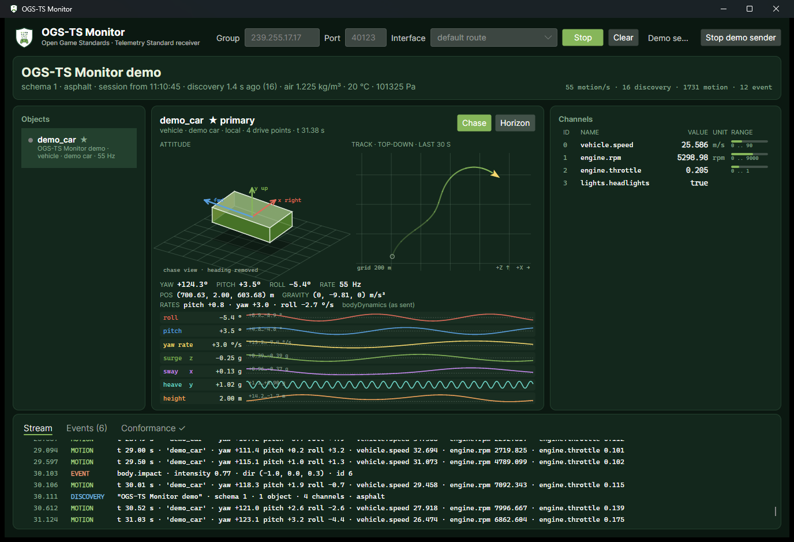

# OGS-TS Monitor

A cross-platform desktop receiver for the
[OGS Telemetry Standard (OGS-TS)](https://github.com/Open-Game-Standards/OGS-Telemetry-Standard):
it joins the multicast group, shows every sender on your network, and checks
everything it receives against the standard as it goes.



Use it to see what a game is sending, to check your own sender while you
build it, or to confirm a loader mod is working before you strap in.

## What it shows

- **Senders and objects:** every discovery session on the network (game,
  schema, environment, gravity) and its objects, with live motion rates.
- **Attitude:** three views, one click apart. **Chase** shows the body axes
  from behind with heading removed, so pitch and roll read the same whichever
  way the object faces (the default for vehicles). **World** shows the body
  axes against fixed world axes, for spacecraft and free 6-DoF motion. Both
  work at any attitude, including inverted or vertical. **Horizon** is an
  aircraft attitude indicator (the default for aircraft).
- **Track:** the last 30 s of position from above, auto-fitted, with heading.
- **Time history:** auto-scaled strips of roll, pitch, yaw rate, surge, sway,
  heave and height, so a car's 2° of roll is as readable as an aircraft's 60°.
- **Channels:** every declared channel with its live value, unit and range.
- **Stream, events and conformance:** a throttled frame log, deduplicated
  events with their replay counts, and conformance findings.

## Conformance checks

Findings are aggregated, so a sender repeating a mistake counts up one row
rather than flooding the list.

| Rule | Level | Checks |
| --- | --- | --- |
| `schema-version` | warning | discovery `schemaVersion` is 1 |
| `gravity-magnitude` | warning | `gravity` equals \|`gravityVector`\| (CONVENTIONS, Gravity) |
| `no-primary` | warning | discovery declares a primary object |
| `duplicate-object`, `duplicate-channel-id` | warning | names and ids identify one thing |
| `quaternion-norm` | warning | orientation is a unit quaternion |
| `primary-first` | warning | motion lists the primary object first |
| `undeclared-object`, `undeclared-channel` | warning | motion only refers to what discovery declared |
| `event-id-order` | warning | new event ids never go backwards (session-monotonic) |
| `event-intensity` | warning | event intensity is within 0..1 (C-3) |
| `motion-before-discovery` | note | motion arriving before anything to interpret it against |
| `out-of-range` | note | a value outside its declared operating range |

The checks follow the reference receiver in
[ogs-ts-dotnet](https://github.com/Open-Game-Standards/ogs-ts-dotnet) and the
schema, and are tested against the standard's conformance corpus.

## Trying it without a game

**Start demo sender** publishes a demo car with body dynamics, channels and
impact events. It is isolated: it sends over the loopback interface on its
own port (40199) with its own receiver, so nothing else on this machine or
your network sees it — a GameConn instance driving a motion rig won't move.
To send the demo on your network as a real sender, start with `--demo-lan`.

The isolated demo has been checked on Windows. Linux often ships with
multicast disabled on the loopback interface; if the demo shows nothing
there, use `--demo-lan` on a network with no rig attached.

## Running

Download a build from
[Releases](https://github.com/Open-Game-Standards/ogs-ts-monitor/releases).
Nothing to install alongside: each is self-contained.

| Platform | Download | Run |
| --- | --- | --- |
| Windows (x64) | `OgsTsMonitor-<version>-win-x64.zip` | unzip, run `OgsTsMonitor.exe` |
| Linux (x64) | `OgsTsMonitor-<version>-linux-x64.tar.gz` | `tar -xzf …` then `./OgsTsMonitor` |
| macOS (Apple silicon / Intel) | `OgsTsMonitor-<version>-osx-arm64.zip` / `-osx-x64.zip` | unzip, move **OGS-TS Monitor** to Applications |

The macOS app is signed with a Developer ID and notarized by Apple. On
macOS 15 and later it asks for **Local Network** access the first time:
allow it, since OGS-TS arrives as multicast on your LAN.

```
OgsTsMonitor [--group 239.255.17.17] [--port 40123] [--demo | --demo-lan]
```

On a machine with several network interfaces, pick the one facing your LAN
in **Interface**: the OS default route can join the group somewhere with no
path to the sender.

## Building

The project references ogs-ts-dotnet by path, and the tests decode the
standard's conformance corpus, so check the three out side by side:

```
Code/
└── Open-Game-Standards/
    ├── ogs-ts-monitor/          ← this repo
    ├── ogs-ts-dotnet/           ← Ogs.Telemetry.Receiving
    └── OGS-Telemetry-Standard/  ← conformance corpus
```

```sh
dotnet build OgsTsMonitor.slnx
dotnet test tests/Ogs.Telemetry.Monitor.Tests
dotnet run --project src/OgsTsMonitor -- --demo
```

Requires the .NET 10 SDK. CI builds, tests and packages on Windows, Linux
and macOS for every push and pull request (each run's artifacts hold the
apps). Pushes to `main` publish a CalVer release (`vYYYY.MM.DD`), as the
loader mods do. The macOS app is assembled, signed and notarized by
`build/macos/bundle.sh` in a separate job that runs in the `release`
environment: only that job sees the Developer ID, and a maintainer approves
it before anything is released.

## Layout and reuse

| Project | What |
| --- | --- |
| `Ogs.Telemetry.Monitor.Core` | UI-free: `StreamTracker` folds decoded frames into snapshots and motion history and runs the conformance checks |
| `Ogs.Telemetry.Monitor` | Avalonia controls: `MonitorView` and the attitude, track and strip-chart views |
| `OgsTsMonitor` | The app: receiver, endpoint settings, demo sender |

Other .NET apps can embed the monitor. Feed a `StreamTracker` from a
`TelemetryReceiver` (or call `Ingest` with raw datagrams) and show it:

```csharp
var tracker = new StreamTracker().Attach(receiver);
var view = new MonitorView { DataContext = new MonitorViewModel(tracker) };
```

## License

MIT. See [LICENSE](LICENSE).
